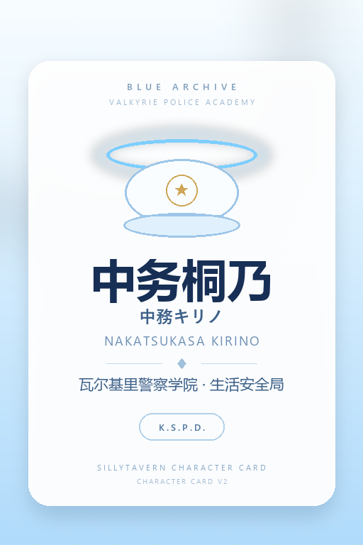

# Nakatsukasa-Kirino-Prompt

从**V2.0**开始，项目名称正式改为**Nakatsukasa-Kirino-Prompt**

---

## 项目地址

[提示词项目地址（github）](https://github.com/R1ce1022/Nakatsukasa-Kirino-Prompt)
[在线体验（需要grok账号）](https://grok.com/project/c687abdd-afc6-46c9-be93-4fbf8da55dc4?tab=conversations)

注意都需要科学上网才能访问

## 简单介绍

一个基于蔚蓝档案角色中务桐乃的提示词项目：既提供可直接丢给 AI 的提示词，也提供打包好的 SillyTavern（酒馆）角色卡。内容用于生成符合人物性格的文本。

## 使用方法

### 方式一：提示词

1. 下载项目提示词到本地。
2. 丢进你的AI模型。
3. 开始对话。

### 方式二：角色卡（SillyTavern / 酒馆）

项目已经把提示词打包成 Character Card V2，直接导入酒馆即可：

| 文件 | 用途 |
| --- | --- |
| [Nakatsukasa-Kirino-Card.png](Nakatsukasa-Kirino-Card.png) | **推荐**：内嵌角色数据的 PNG，带占位头像，导入即用 |
| [Nakatsukasa-Kirino-Card.json](Nakatsukasa-Kirino-Card.json) | 纯 JSON 版，方便查看和二次编辑；导入后没有头像 |
| [tools/build_card.py](tools/build_card.py) | 改完 JSON 后重新生成 PNG、校验结构、替换头像 |



**导入步骤**

1. 打开 SillyTavern → 角色管理（人物头像栏）→ 导入角色（Import Character）。
2. 选择 `Nakatsukasa-Kirino-Card.png`。
3. 选中「中务桐乃」开始新聊天；首条消息可左右滑动，切换 5 个开场场景。

**卡片里有什么**

- description / personality / scenario：身份、外貌、性格、8 条行为准则
- 1 个默认开场 + 4 个备选开场
- 6 段对话示例
- 内嵌人物书 6 条：好感度系统（常驻）、合欢垣吹雪、尾刃康娜、瓦尔基里与生活安全局、夏莱与老师、基沃托斯的枪械与光环
- depth 4 的角色小抄，用于长对话里提醒语气和边界
- `system_prompt` / `post_history_instructions` 留空，不覆盖你自己的预设与越狱

**改内容 / 换头像**

修改 `Nakatsukasa-Kirino-Card.json` 后运行：

```powershell
# 重新生成默认占位头像的 PNG
python tools/build_card.py

# 用自己的立绘（自动居中裁剪为 512x768）
python tools/build_card.py --avatar 你的图片.png

# 只校验 JSON，不生成 PNG
python tools/build_card.py --check
```

需要 Python 3.10+ 和 Pillow（`pip install pillow`）。也可以直接在酒馆的角色编辑器里改，再重新导出。

**注意**

- 头像是浅蓝警察主题的**占位图**，不是官方立绘；换图方法见上。
- 用卡片时不要再把原 Prompt 重复贴进对话，避免重复设定。
- 角色卡能改善设定加载、开场、示例与长期一致性，但回答质量仍取决于模型、预设、上下文和温度。
- 卡片依赖酒馆的「角色人物书 / Character Lorebook」功能（默认启用）。如果发现吹雪、康娜等资料没加载，检查该功能是否关闭。
- 非官方同人作品，角色版权归 NEXON / 蔚蓝档案所有。
